  

  <b>BCA student at CHARUSAT · Full-stack developer in the making</b> 
  I build web apps with React, Node.js and MongoDB, and I like turning real problems into working products.

  
  
  

---

### 🚀 About me

- 🎓 Studying BCA at **CHARUSAT**, based in Nadiad, Gujarat
- 🔭 Currently building **Harvest** (an ERP with a React client and an Express API)
- 🤝 Contributing to client projects in the **techend-dev** organisation and to open source
- 🌱 Learning: system design, testing, and shipping production-ready full-stack apps
- 💡 Interested in full-stack development, AI-powered apps and IoT

### 🛠️ Tech stack

---

### 📌 Featured projects

| Project | What it is | Stack |
|---|---|---|
| [**Placeble**](https://github.com/DHRUV-PATEL1937/Placeble) | Placement preparation platform with separate frontend and backend apps | React, Vite, TypeScript, Express, MongoDB |
| [**Harvest ERP**](https://github.com/DHRUV-PATEL1937/ERP-client) ([API](https://github.com/DHRUV-PATEL1937/ERP-server)) | ERP with a React SPA and a standalone REST API (contacts, products, orders, invoices, payments, pricing) | React, Vite, Express, Mongoose |
| [**AnnSetu**](https://github.com/DHRUV-PATEL1937/AnnSetu) ([server](https://github.com/DHRUV-PATEL1937/AnnSetu-server)) | React client with an Express + MongoDB server using the Sarvam API | React, Vite, Express, MongoDB |
| [**SocialMediaAutomation**](https://github.com/DHRUV-PATEL1937/SocialMediaAutomation) | Posts the next queued video from Google Drive to YouTube Shorts and Instagram Reels on a GitHub Actions schedule | Python, GitHub Actions |
| [**QuickMeasure**](https://github.com/DHRUV-PATEL1937/QuickMeasure) | React + TypeScript web app | React, TypeScript, Vite |
| [**AI Voice Detection API**](https://github.com/DHRUV-PATEL1937/ai-voice-detection-api) | Multilingual AI voice detection system | Python |
| [**IOT**](https://github.com/DHRUV-PATEL1937/IOT) | Arduino and ESP32 projects for automation and real-time monitoring | C++ |

---

### 🤝 Open-source and team contributions

**Merged pull requests**

| Repository | Merged PRs | Highlights |
|---|---|---|
| [techend-dev/schoolchamps-admin-server](https://github.com/techend-dev/schoolchamps-admin-server) | 5 | AI response parsing hardening, WordPress auth, password reset emails, admin analytics |
| [techend-dev/schoolchamps-admin-client](https://github.com/techend-dev/schoolchamps-admin-client) | 5 | Super-admin dashboard and school analytics, attachment validation, certificate flow |
| [techend-dev/schoolchamps.in](https://github.com/techend-dev/schoolchamps.in) | 2 | Brand logo in navbar and footer, Privacy Policy and Terms pages |
| [techend-dev/grovia](https://github.com/techend-dev/grovia) | 2 | 3D agentic-AI website redesign, responsive scaling fixes |

**Open pull requests**

- [TMHSDigital/Static_Chess #73](https://github.com/TMHSDigital/Static_Chess/pull/73): fix for a horizontal scrollbar in narrow windows (CSS)

---

### 🐍 Contribution snake

  <picture>
    <source media="(prefers-color-scheme: dark)" srcset="https://raw.githubusercontent.com/DHRUV-PATEL1937/DHRUV-PATEL1937/output/github-snake-dark.svg" />
    <source media="(prefers-color-scheme: light)" srcset="https://raw.githubusercontent.com/DHRUV-PATEL1937/DHRUV-PATEL1937/output/github-snake.svg" />
    
  </picture>

### 📊 GitHub stats

  
  

  

---

### 📫 Let's connect

I'm open to internships, freelance work and collaboration on web projects.
Reach me on [LinkedIn](https://www.linkedin.com/in/dhruv-patel-894654318) or at dhruvpatel27106@gmail.com.

<i>Thanks for stopping by ⭐</i>

